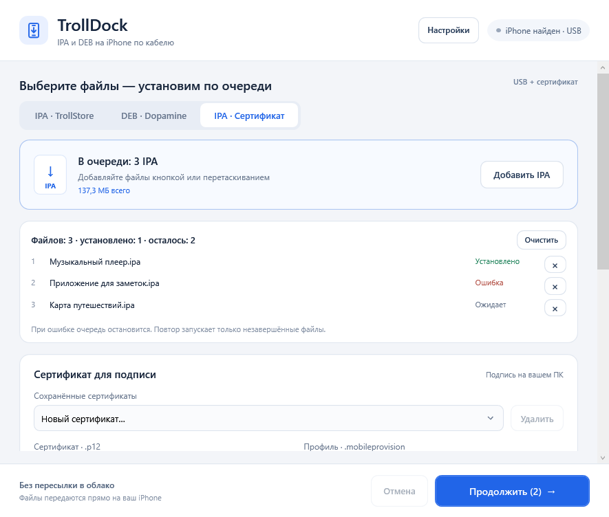
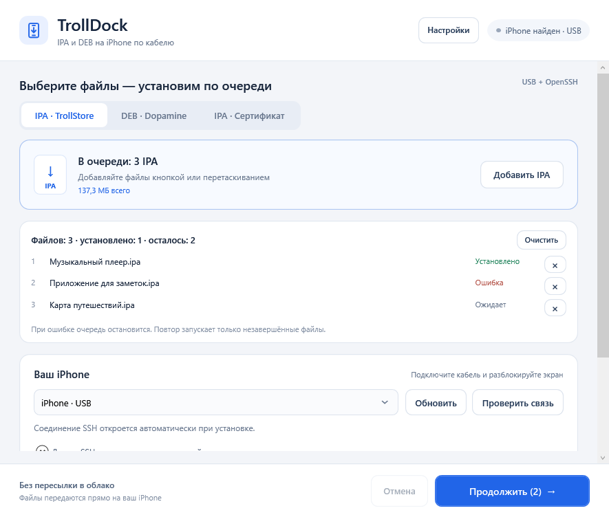
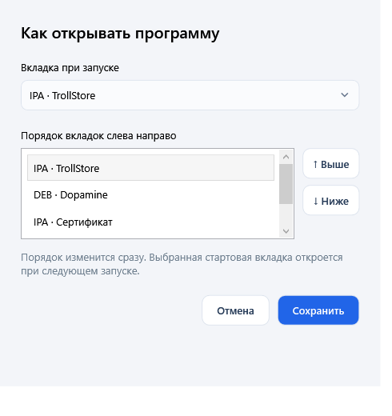

# TrollDock

Windows-программа для установки приложений и пакетов на iPhone по USB.

**[Скачать последнюю версию для Windows x64](https://github.com/saxsofonist/TrollDock/releases/latest)**

## Три способа установки

- **IPA · TrollStore** — открывает USB-туннель, подключается по SSH и устанавливает приложение через TrollStore.
- **DEB · Dopamine** — проверяет архитектуру и зависимости, устанавливает пакет через APT/dpkg. Перезапуск интерфейса доступен отдельной кнопкой.
- **IPA · Сертификат** — подписывает рабочую копию IPA вашим P12/PFX и профилем `.mobileprovision`, затем устанавливает её по обычному USB-подключению. SSH и jailbreak для этого режима не требуются.



## Быстрый запуск

1. Скачайте ZIP из Releases и распакуйте **всю папку**, включая `tools`.
2. Запустите `TrollDock.exe`. Устанавливать .NET отдельно не нужно.
3. Подключите iPhone кабелем, разблокируйте экран и подтвердите доверие компьютеру.
4. Выберите способ установки, добавьте один или несколько файлов и нажмите кнопку установки.

На Windows должен быть установлен драйвер Apple Mobile Device: например, из Apple Devices, iTunes или 3uTools. При нескольких подключённых устройствах выберите нужное в списке.

Для TrollStore/DEB нужны активный jailbreak и OpenSSH. Данные SSH доступны в дополнительных настройках; начальные значения — `root` / `alpine`, их можно изменить. Программа открывает туннель самостоятельно; также поддерживается готовый локальный туннель.

## Пакетная установка



Выберите несколько файлов в диалоге или перетащите их в окно. У каждой вкладки своя очередь: в ней видны имена файлов и результат установки каждого. Можно добавлять файлы, удалять выбранные строки и очищать список. Повторное добавление того же пути не создаёт дубликат; IPA и DEB в одной очереди не смешиваются.

IPA через TrollStore или сертификат устанавливаются последовательно. SSH подключается один раз на очередь; для сертификатной установки один выбранный сертификат применяется ко всем IPA. Временные подписанные файлы удаляются после каждого приложения, исходники остаются на ПК.

Несколько DEB передаются в одну операцию APT: зависимости могут разрешаться между выбранными локальными пакетами. До установки проверяются все файлы, архитектура и зависимости; после — состояние и версия каждого пакета. Автоматического Respring нет.

При ошибке очередь IPA останавливается. Уже подтверждённые установки сохраняют свой статус и не повторяются при следующем запуске той же очереди. Для DEB показываются результаты проверки каждого пакета, включая частичный успех. Остановка во время подготовки отменяет её; уже начавшаяся установка завершается, после чего следующие файлы не запускаются.

## Установка с сертификатом

Нужны сертификат с закрытым ключом (`.p12` или `.pfx`), его пароль и соответствующий `.mobileprovision` для Development, Ad Hoc или Enterprise. Пароль может быть пустым, если так сохранён ваш P12.

Выберите файлы на вкладке **IPA · Сертификат**. При желании отметьте «Сохранить сертификат с именем» и задайте имя. Сохранённая запись включает сертификат, профиль и пароль; всё содержимое шифруется Windows DPAPI для текущей учётной записи. При следующем запуске запись доступна в списке. Исходные файлы сертификата и профиля не меняются.

Проверяются соответствие ключа и сертификата, целостность профиля, сроки действия и разрешённый UDID. Исходные Bundle ID приложения и его расширений сохраняются. Начиная с версии 1.1.1 различие между App ID профиля и Bundle ID приложения не блокирует подпись в TrollDock. Apple проверяет доверие и статус сертификата при установке.

### Что происходит с файлами

Исходная IPA открывается только для чтения. Подпись выполняется в отдельной временной папке, доступной текущему пользователю Windows. Пароль сертификата не передаётся в командной строке.

После установки, ошибки или отмены подписанная IPA, рабочая копия и временные данные сертификата удаляются напрямую, **без корзины**. Если программа аварийно закрылась, оставшиеся задания очищаются при следующем запуске. Если Windows блокирует удаление, программа сообщает об этом и сохраняет отметку для повторной очистки; успешное удаление в таком случае не утверждается.

## Настройки вкладок

Кнопка **«Настройки»** позволяет выбрать вкладку при запуске и изменить порядок всех трёх вкладок кнопками «Выше» / «Ниже». Порядок применяется сразу, стартовая вкладка — при следующем запуске.



Настройки и сохранённые сертификаты находятся в папке `data` рядом с программой. Для обновления распакуйте новую версию в ту же доступную для записи папку, сохранив `data`. Шифрованные записи привязаны к пользователю Windows.

## Сборка и проверки

Нужны Windows x64, .NET SDK 10 и Python 3 для загрузки закреплённых инструментов: исправленного подписывателя TrollDock и официального go-ios.

```powershell
./build.ps1
```

Скрипт собирает автономную программу, скачивает закреплённые версии инструментов с проверкой SHA-256 и создаёт ZIP в `artifacts`.

Проверки без установки на iPhone:

```powershell
dotnet run --project TrollDock.Transport.Tests
dotnet run --project TrollDock.AppTests
dotnet run --project TrollDock.CertificateTests
dotnet run --project TrollDock.WorkflowTests
dotnet run --project DebWorkflowTests
dotnet run --project TrollDock.BatchTests
dotnet run --project TrollDock.UiTests
```

Или выполните `./test.ps1`, чтобы запустить все перечисленные проверки. DEB-тестам нужен Git Bash. Windows DPAPI и некоторые проверки файловой системы требуют обычного пользовательского сеанса Windows. Тесты не устанавливают приложения или пакеты на телефон.

Для дополнительных проверок запуска инструментов и подписи синтетического Mach-O выполните `./test.ps1 -IncludeTools`. Этот режим загружает закреплённые инструменты, создаёт искусственные тестовые сертификаты и не предназначенный для запуска IPA локально. Тестовые файлы исключены из Git и релизов; действующие Apple-сертификаты для этих проверок не нужны.

В версии 1.2.0 прошли 17 проверок очереди, 24 проверки WPF-интерфейса, 94 проверки установки и очистки и 39 проверок DEB. Они используют локальные тестовые данные и имитацию ответов устройства. Ранее реальная IPA успешно подписана действующим Apple-сертификатом: подпись проверена, исходный Bundle ID и исходный файл сохранены, временные файлы удалены. Пакетная установка версии 1.2.0 на реальном iPhone пока не проверялась.

## Используемые проекты

- [TrollStore](https://github.com/opa334/TrollStore) и [Dopamine](https://github.com/opa334/Dopamine).
- [SSH.NET](https://github.com/sshnet/SSH.NET) — SSH/SFTP.
- [zsign](https://github.com/zhlynn/zsign) **1.1.3-trolldock.2** — сборка TrollDock на основе zsign 1.1.3. Формирует entitlements отдельно для каждого приложения и расширения, сохраняет их исходные Bundle ID и вкладывает выбранный профиль в подписываемые приложения и расширения.
- [go-ios](https://github.com/danielpaulus/go-ios) 1.3.2 — установка по USB.

Версии, ссылки и контрольные суммы внешних инструментов закреплены в `certificate-tools/manifest.json`. Происхождение инструментов описано в [certificate-tools/README.txt](certificate-tools/README.txt), исходный патч и рецепт сборки подписывателя — в [certificate-tools/zsign-patch](certificate-tools/zsign-patch/README.txt). Лицензии включены в исходники и релиз.

IPA, DEB, сертификаты и пароли не отправляются в облако программой TrollDock. APT на телефоне может скачивать зависимости из настроенных репозиториев.
